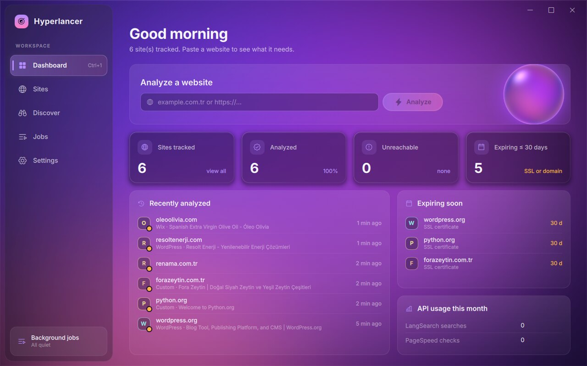
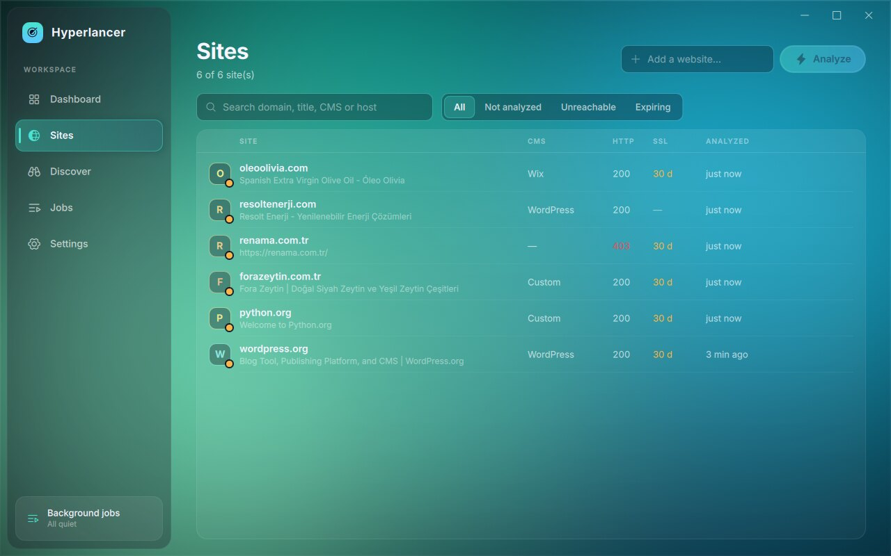
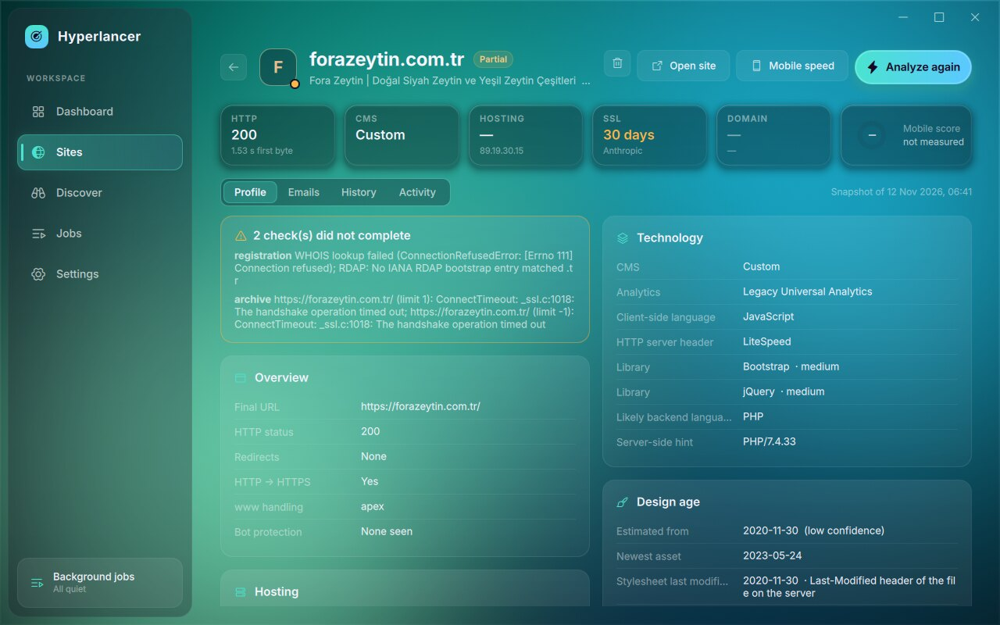
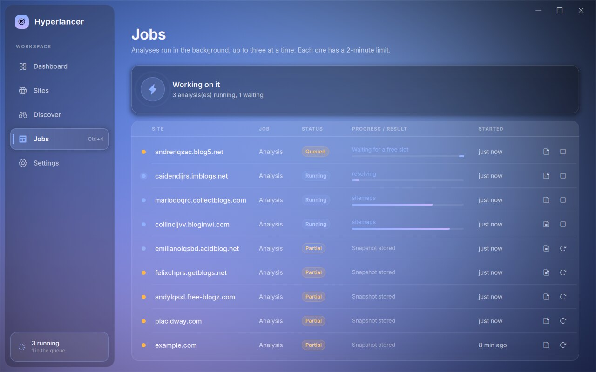

# Hyperlancer

A Windows desktop app for a freelance web developer: find businesses with weak websites,
analyze each site, and keep everything about a lead in one place. Built with C++, Qt 6.11
(Qt Quick) and CMake. The site analysis itself runs in the Python tools under
`web-dashboard/scripts`.

The product requirements are in [docs/PRD-Freelance-lead-generation-desktop-app.md](docs/PRD-Freelance-lead-generation-desktop-app.md).
What is built so far, and what comes next, is in [docs/PROGRESS.md](docs/PROGRESS.md).

| Dashboard | Sites |
|---|---|
|  |  |
| **Site detail** | **Jobs** |
|  |  |

## What it does today

- **Analyze a website.** Paste a URL; the profiler checks HTTP, technology and CMS, hosting,
  DNS and email records, SSL, domain registration, SEO, sitemaps, security headers, contact
  channels and design age. Progress shows step by step; every attempt is stored as a snapshot.
- **Mobile speed.** PageSpeed Insights mobile score and Core Web Vitals per site.
- **Discover.** Web search through the LangSearch API; results are grouped per website, marked
  new or already known, and added to Sites with one click (optionally analyzed right away).
- **Gmail (read-only).** Emails exchanged with a site's domain, on the site's Emails tab.
- **Jobs.** Up to three analyses run in the background; cancel, retry, open the log.
- **Settings.** API keys (replaceable at any time), database (local SQLite or remote MySQL),
  Python tool paths, appearance, and a health check with a fix hint per problem.

## Requirements

- Windows 10 or 11 (Linux works for development)
- **Qt 6.11** with the MinGW 64-bit kit and these components: **Qt Shader Tools**,
  **Qt WebSockets**, **Qt Network Authorization**. Qt Quick, Qt SQL and Qt Network are part of
  the base install.
- CMake 3.21 or newer and Ninja (both come with the Qt installer under *Developer and
  Designer Tools*)
- Python 3.11+ and [uv](https://docs.astral.sh/uv/) for the analysis tools

## Build and run on Windows

In the Qt Maintenance Tool, add the components listed above to your Qt 6.11 MinGW kit. Then,
in PowerShell from the project folder (adjust the version folder to yours):

```powershell
$env:Path = "C:\Qt\6.11.3\mingw_64\bin;C:\Qt\Tools\mingw1310_64\bin;C:\Qt\Tools\Ninja;C:\Qt\Tools\CMake_64\bin;$env:Path"
cmake -S . -B build -G Ninja -DCMAKE_BUILD_TYPE=Release `
  -DCMAKE_PREFIX_PATH="C:/Qt/6.11.3/mingw_64" `
  -DCMAKE_CXX_COMPILER="C:/Qt/Tools/mingw1310_64/bin/g++.exe"
cmake --build build --parallel
```

Prepare the Python tools once (and again after pulling changes to `web-dashboard/scripts`):

```powershell
uv sync --project web-dashboard\scripts
```

Run `build\Hyperlancer.exe`. The app finds `web-dashboard\scripts` by looking upward from the
executable, so a build inside the project folder needs no setup. Settings → Health shows
whether Python and the tools were found.

The project always uses the single `build` folder; to start fresh, delete it and configure
again.

## Build on Linux

```bash
cmake -S . -B build -G Ninja -DCMAKE_PREFIX_PATH=/path/to/Qt/6.11.3/gcc_64
cmake --build build --parallel
uv sync --project web-dashboard/scripts
./build/Hyperlancer
```

On Linux, keys are kept in an unencrypted file in the data folder (development only).

## Keys and accounts

All keys and passwords are stored in **Windows Credential Manager** (Control Panel →
Credential Manager → Windows Credentials, entries named `Hyperlancer/...`). They never go into
the settings file or the database.

### LangSearch (Discover)

Settings → Connections → LangSearch → **Add key** and paste the key. When you rotate the key in
the LangSearch dashboard, use **Replace** to paste the new one; **Test** runs one small search.
Note: LangSearch returns no results for quoted exact phrases, so write footer phrases without
quotes.

### PageSpeed Insights (Mobile speed)

Optional but recommended. In the same Google Cloud project where PageSpeed Insights is enabled:
*APIs & Services → Credentials → Create credentials → API key*, restrict it to the PageSpeed
Insights API, then paste it in Settings → Connections → PageSpeed Insights. The key starts with
`AIza`; the OAuth client secret (`GOCSPX-…`) from the Gmail client file does not work here and
is refused. Without a key the app uses Google's small shared anonymous quota, which is often
used up.

### Gmail (your `client_secret_....apps.googleusercontent.com.json` file)

1. In Google Cloud Console, the OAuth client must be of type **Desktop app**, the consent
   screen **Internal** to your Workspace organization, and the Gmail API enabled.
2. In the app: Settings → Connections → Gmail → **Import file…** and choose the JSON file.
   The client ID and secret are copied into Windows Credential Manager. After that the app no
   longer needs the file: move it somewhere private (not into this repository) or delete it.
3. Click **Connect**. Your browser opens Google's consent page; approve read-only Gmail access.
   The browser then shows "Hyperlancer is now connected"; you can close the tab.
4. Open a site → **Emails** to see messages with that domain. Free-mail domains (gmail.com,
   hotmail.com, …) are never matched by domain.

The app asks only for `gmail.readonly`: it cannot send, delete or change mail. **Disconnect**
revokes the token at Google.

## Database

By default records are kept in a local SQLite file in the data folder
(`%APPDATA%\HyperGrapher\Hyperlancer`). To use a remote MySQL or MariaDB server instead:
Settings → Database → **MySQL (remote)**, fill in host, port, database, user and password,
click **Test connection**, then **Save and restart**. Tables are created on the first
connection. Switching does not copy records between databases.

Use a dedicated MySQL user with rights on one schema only, and keep **TLS** on if the server
supports it.

### MySQL driver on Windows

Qt's official Windows packages do not include the MySQL driver. The release package built by
GitHub Actions (`hyperlancer-windows-x64.zip`) contains it: `sqldrivers\qsqlmysql.dll`, built
against the MariaDB client, plus `libmariadb.dll` and the DLLs it needs next to
`Hyperlancer.exe`. Settings → Health shows "MySQL driver" in green when it is available.

For your own local build, either copy those files from the release zip into
`C:\Qt\6.11.3\mingw_64\plugins\sqldrivers` (the plugin) and next to your `Hyperlancer.exe`
(the DLLs), or build the plugin yourself as `.github/scripts/build_mysql_driver.sh` does.

## Run options

| Option | Effect |
|---|---|
| `--data-dir <dir>` | Use another data folder (database, job files, logs). |
| `--settings <file>` | Use another settings file. |
| `--reduced-motion` | Start in reduced-motion mode for this session. |
| `--no-translucency` | Opaque window with square corners (for X11 without a compositor). |
| `--tour <dir>` | Automated tour: visits every section, saves screenshots, checks rapid switching, then quits. |

Keyboard: `Ctrl+1` … `Ctrl+5` switch sections, `Up`/`Down` move in the sidebar, `Esc` leaves
a site's detail view.

## Tests

```bash
ctest --test-dir build --output-on-failure
uv run --project web-dashboard/scripts pytest web-dashboard/scripts
```

The C++ tests cover URL normalization and the Public Suffix List, NDJSON parsing, migrations,
snapshot ingest, the job queue, site queries, the LangSearch, PageSpeed and Gmail parsers, and
settings. To also run the migration test against MySQL, set
`HYPERLANCER_TEST_MYSQL=host;port;database;user;password` (an empty test database).

CI (`.github/workflows/ci.yml`) builds and tests on Linux and Windows with Qt 6.11.3, runs the
screenshot tour under Xvfb, and runs the Python tests. On Windows, Qt is installed by
`.github/scripts/install_qt_windows.py` (aqtinstall cannot read Qt 6.11's new Windows package
layout yet) and the MySQL driver is built by `.github/scripts/build_mysql_driver.sh`.

## Project layout

```
src/                 C++: app setup, database thread and migrations, stores, job runner,
                     API clients (LangSearch, PageSpeed, Gmail), QML-facing models
src/qml/             QML: Main.qml, theme/, shell/, navigation/, pages/, controls/, effects/
src/shaders/         GLSL fragment shaders, compiled to .qsb at build time
resources/           Fonts, Public Suffix List, SQL migrations (sqlite/ and mysql/)
tests/               Qt Test unit tests
web-dashboard/       The earlier web version; its Python tools (scripts/) do the site analysis
docs/                PRD, progress notes, screenshots
```

## Design

The interface keeps the visual language of the original Qt template: a slowly moving aurora
background, glass panels, a liquid selection pill in the sidebar, and one color mood per section
(Dashboard violet, Sites teal, Discover amber, Jobs blue, Settings green). Pages arrive in a
staggered wave; lists are plain table rows with aligned columns. All design values are in
`src/qml/theme/` (`Theme.qml`, `Motion.qml`, `Palettes.qml`, `Icons.qml`, `Format.qml`).
Settings → Appearance has reduced motion and a performance overlay.

## GitHub releases

Push a version tag such as `v0.2.0` to build portable packages for Windows x64 and Linux x64.
The Windows zip contains the app, the Qt runtime, the MySQL driver and the Python tools folder;
after unpacking, run `uv sync --project web-dashboard\scripts` inside it once.

```bash
git tag v0.2.0
git push origin v0.2.0
```

Or, without pushing a tag: GitHub → Actions → "Build portable releases" → **Run workflow**,
enter the version (for example `v0.3.0`); the workflow creates the tag with the release.
